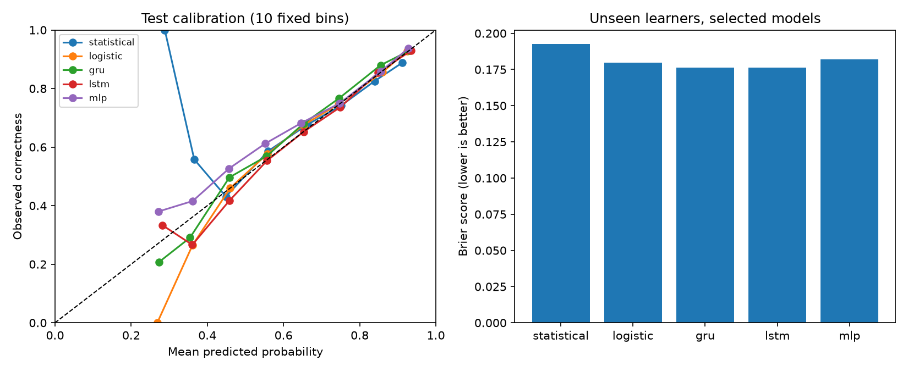
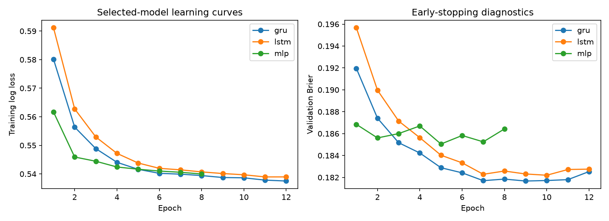
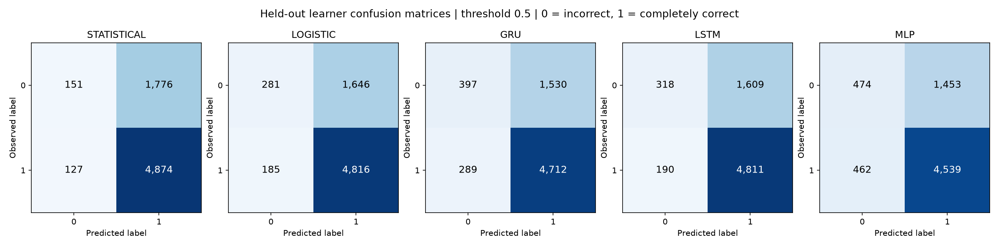
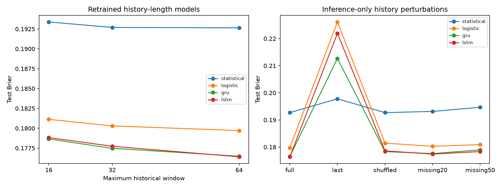

# Real-World Knowledge Tracing Benchmark v0.1 — measured pilot

Run date: 2026-11-22. This report contains measured outcomes from the pinned real SLAM dataset. Models, windows and controls were frozen before opening the 15 held-out learners. No production code, live SQLite records or previous experiments were changed.

**Finding:** both recurrent models improve next-exercise probability prediction over historical statistics and engineered logistic regression on unseen learners. The extra benefit attributable to order is modest: the GRU ordering contrast favors chronological history, while the LSTM ordering interval includes zero. Exercise/session metadata and historical correctness explain substantially more than timing. This is promising pilot evidence, not a reason to increase architectural complexity immediately.

## Data and frozen configuration

100 deterministic learners; 70/15/15 learner-disjoint splits; 41,852 interactions. Train/validation/test prediction targets: 29,636 / 5,188 / 6,928. Test has 5,001 completely correct and 1,927 incorrect exercises (72.1853% positive), from 15 learners. Each learner’s first observed interaction is history only. Later observed outcomes update that learner’s history without updating model weights. Source partitions are reconstructed chronologically before the new learner split. See [audit](DATASET_AUDIT.md) and [machine-readable provenance](provenance.json).

Windows: 16/32/64; expanding history is an additional statistical candidate. Seed 42; CPU only; two threads; batch 256; one GRU/LSTM layer, hidden size 32; AdamW lr 0.003, weight decay 0.0001; BCEWithLogitsLoss; clip norm 1; maximum 12 epochs; early-stop patience 3 using validation Brier. Training-only medians, scalers and vocabularies; packed valid sequence lengths; sigmoid at evaluation. Target context is restricted to format/session. Target days, response duration, outcomes and all reference-derived fields are excluded.

The statistical model selected window 32 and smoothing strength 10; logistic selected window 64 and C=10; both recurrent models selected window 64. Checkpoints selected: GRU epoch 9, LSTM epoch 10. The 143-hidden-unit summary-only MLP selected epoch 5 and approximately matches GRU capacity. Main selections compare the full feature contract; retrained ablations are diagnostics, not a test-driven replacement of those selections.

## Main comparison

All rows use exactly the same 6,928 targets and 15 learners. Lower Brier/log loss is better. PR-AUC is average precision (AP). No test calibration or threshold fitting occurred.

| Model | Window | Validation Brier | Test Brier | Log loss | ROC-AUC | PR-AP | Learner-macro Brier |
|---|---:|---:|---:|---:|---:|---:|---:|
| statistical | 32 | 0.200072 | 0.192695 | 0.571524 | 0.622316 | 0.794972 | 0.188607 |
| logistic | 64 | 0.185893 | 0.179712 | 0.536328 | 0.701540 | 0.852554 | 0.172569 |
| gru | 64 | 0.181670 | 0.176478 | 0.528538 | 0.718938 | 0.861894 | 0.169936 |
| lstm | 64 | 0.182197 | 0.176403 | 0.528446 | 0.719031 | 0.861435 | 0.170079 |
| mlp | 64 | 0.185048 | 0.181966 | 0.540266 | 0.703265 | 0.855188 | 0.172791 |

| Model | Accuracy @0.5 | Precision | Recall | F1 | ECE (10 bins) | Mean probability |
|---|---:|---:|---:|---:|---:|---:|
| statistical | 0.725318 | 0.732932 | 0.974605 | 0.836666 | 0.015044 | 0.722338 |
| logistic | 0.735710 | 0.745280 | 0.963007 | 0.840269 | 0.012884 | 0.714606 |
| gru | 0.737442 | 0.754886 | 0.942212 | 0.838210 | 0.021907 | 0.704662 |
| lstm | 0.740329 | 0.749377 | 0.962008 | 0.842483 | 0.009622 | 0.729169 |
| mlp | 0.723585 | 0.757510 | 0.907618 | 0.825798 | 0.029838 | 0.692015 |

The always-correct accuracy is 0.721853. LSTM’s pooled Brier is only 0.000075 lower than GRU’s, while GRU has the lower learner-macro Brier. This does not establish an architecture winner. GRU improves Brier and discrimination but has worse ECE than logistic regression; better discrimination does not guarantee better calibration. Low-probability reliability bins can be sparse (one statistical-model bin contains one target).

| Paired contrast | Learner-macro Brier difference | Descriptive 95% learner-bootstrap interval |
|---|---:|---|
| gru minus logistic | -0.002633 | [-0.005500, -0.000409] |
| lstm minus logistic | -0.002491 | [-0.004103, -0.001001] |
| mlp minus logistic | +0.000221 | [-0.001754, +0.002493] |
| gru minus summary MLP | -0.002855 | [-0.006265, -0.000160] |
| lstm minus summary MLP | -0.002712 | [-0.005946, -0.000224] |

The reference baseline was selected by validation Brier. Intervals use 2,000 paired resamples of whole learners, conditional on this split and these fitted models. Negative favors the first model. They do not include seed/split uncertainty or a multiple-comparison correction.

## Retrained controls: what explains the gain?

Controls keep the main model’s selected window and hyperparameters; each checkpoint is selected on validation. Feature removals retain tensor dimensions and parameter counts. The contrast is ordered/full minus the retrained control, using equal learner weights.

| Model | Control | Validation Brier | Test Brier | Macro difference | 95% paired learner interval |
|---|---|---:|---:|---:|---|
| logistic | last | 0.192591 | 0.184666 | -0.005448 | [-0.014108, -0.000162] |
| gru | last | 0.191119 | 0.182832 | -0.006622 | [-0.016347, -0.000651] |
| lstm | last | 0.191322 | 0.182853 | -0.006683 | [-0.015402, -0.001115] |
| logistic | shuffled | 0.187075 | 0.181207 | -0.001076 | [-0.001946, -0.000294] |
| gru | shuffled | 0.182587 | 0.178107 | -0.001264 | [-0.002423, -0.000142] |
| lstm | shuffled | 0.183713 | 0.178375 | -0.001368 | [-0.003346, +0.000570] |
| logistic | no_correctness | 0.193268 | 0.185723 | -0.006669 | [-0.016857, -0.000391] |
| gru | no_correctness | 0.190318 | 0.183094 | -0.007018 | [-0.017786, -0.000730] |
| lstm | no_correctness | 0.191110 | 0.183706 | -0.007532 | [-0.017217, -0.001407] |
| logistic | no_time | 0.185570 | 0.179625 | -0.000133 | [-0.000495, +0.000234] |
| gru | no_time | 0.181496 | 0.176593 | -0.000268 | [-0.001093, +0.000567] |
| lstm | no_time | 0.181971 | 0.176681 | -0.000092 | [-0.001529, +0.001901] |
| logistic | no_metadata | 0.198731 | 0.190130 | -0.013366 | [-0.021199, -0.006928] |
| gru | no_metadata | 0.198279 | 0.189948 | -0.015614 | [-0.025665, -0.008556] |
| lstm | no_metadata | 0.198399 | 0.189801 | -0.015540 | [-0.024114, -0.009435] |

- **Order:** retrained shuffled GRU/LSTM test Brier is 0.178107/0.178375, versus ordered 0.176478/0.176403. The GRU learner-macro ordering interval excludes zero narrowly; the LSTM interval crosses zero. Logistic also benefits from its explicitly order-sensitive summaries. Shuffling permutes complete bundles and recomputes summaries; historical incoming gaps remain attached, so it removes event sequence order without erasing all temporal context.
- **Correctness:** removing past correctness degrades GRU/LSTM to 0.183094/0.183706. Prior outcomes matter, but this alone would not establish a temporal-order effect.
- **Timing:** removing historical gaps and response durations gives 0.176593/0.176681, essentially the full-model performance; all timing contrast intervals cross zero. This joint ablation cannot separate duration from gap effects. Target submission time was never supplied.
- **Metadata:** removing format/session from both history and target raises GRU/LSTM Brier to 0.189948/0.189801. Context composition explains a large part of predictive quality. These are observed prediction relationships, not causal effects of exercise selection.
- **Capacity:** the 4,863-parameter MLP is worse than the 4,865-parameter GRU on pooled and learner-macro Brier. However, the MLP sees summaries rather than individual events, and shuffled recurrence still performs well. Rich unordered event information remains an alternative explanation for much of the recurrent advantage.

## History length and missing events

| Model | 16-event test Brier | 32-event test Brier | 64-event test Brier |
|---|---:|---:|---:|
| statistical | 0.193390 | 0.192695 | 0.192644 |
| logistic | 0.181125 | 0.180291 | 0.179712 |
| gru | 0.178644 | 0.177472 | 0.176478 |
| lstm | 0.178825 | 0.177734 | 0.176403 |

The expanding-history statistical candidate scores 0.193613. Statistical window 32 remains the primary selection even though the 64-event candidate has slightly lower test Brier; test did not select its window. Longer bounded histories improve recurrent predictions in this pilot; unbounded recurrent history was not tested.

| Model | Full selected window | Last-only perturbation | Shuffled perturbation | Missing 20% | Missing 50% |
|---|---:|---:|---:|---:|---:|
| statistical | 0.192695 | 0.197800 | 0.192695 | 0.193142 | 0.194669 |
| logistic | 0.179712 | 0.226147 | 0.181451 | 0.180286 | 0.180892 |
| gru | 0.176478 | 0.212706 | 0.178308 | 0.177597 | 0.178959 |
| lstm | 0.176403 | 0.221948 | 0.178605 | 0.177393 | 0.178339 |
| mlp | 0.181966 | 0.197279 | 0.183943 | 0.182900 | 0.184273 |

These are **inference-only perturbations** of the chronological model, distinct from the retrained controls above. In particular, last-only distribution shift is much worse than retraining with one event. Missingness removes whole visible events, does not refill the window, preserves incoming-gap bundles and assumes the total prior-attempt count remains known. It is synthetic MCAR stress, not an estimate of real missing-data mechanisms. All targets remain evaluated.

| Prior-history slice | Targets | Positive rate | Logistic Brier | GRU Brier | LSTM Brier |
|---|---:|---:|---:|---:|---:|
| short_prior_1_to_15 | 225 | 0.840000 | 0.135955 | 0.137349 | 0.136244 |
| medium_prior_16_to_63 | 720 | 0.815278 | 0.138527 | 0.136498 | 0.136739 |
| long_prior_64_plus | 5,983 | 0.706167 | 0.186314 | 0.182760 | 0.182686 |

Longer-history slices contain harder/later interactions and a different positive rate. Their higher Brier is not evidence that adding history causes worse prediction. GRU is slightly worse than logistic on the small early slice.

## Calibration, learning curves and failures









GRU underestimates aggregate correctness (mean probability 0.704662 versus 0.721853 observed); LSTM averages 0.729169. No post-test correction was fitted. At threshold 0.5, GRU detects only 397 of 1,927 incorrect exercises; LSTM detects 318. High positive recall is not strong error detection. GRU/LSTM assign probability >=0.9 to 67/79 incorrect attempts. These are aggregate failure counts, with no individual records disclosed.

| Exercise format | Targets | Correct rate | Logistic Brier | GRU Brier | LSTM Brier |
|---|---:|---:|---:|---:|---:|
| listen | 1,858 | 0.674381 | 0.205741 | 0.198821 | 0.197010 |
| reverse_tap | 2,039 | 0.893085 | 0.094906 | 0.093547 | 0.093500 |
| reverse_translate | 3,031 | 0.635764 | 0.220807 | 0.218570 | 0.219540 |

Translation remains the hardest format under Brier; tapping has a much higher correct rate. Cohort composition and exercise assignment can explain associations. No literal answers, original learner IDs, per-learner predictions or raw records are exported.

## Resource measurements and validation

| Model | Parameters | Fit + validation seconds | Predictor KiB | Inference median ms | Inference p95 ms | Sampled process RSS MiB |
|---|---:|---:|---:|---:|---:|---:|
| statistical | 2 | 0.172 | 1.62 | 0.691 | 2.106 | 367.64 |
| logistic | 33 | 0.254 | 2.42 | 0.571 | 1.640 | 382.77 |
| gru | 4,865 | 169.838 | 23.27 | 1.890 | 4.541 | 418.27 |
| lstm | 6,465 | 238.984 | 29.52 | 1.690 | 3.403 | 429.08 |
| mlp | 4,863 | 5.864 | 22.90 | 0.593 | 1.415 | 427.41 |

Full search: 28 main/capacity candidates plus 15 retrained controls; 2,112.29 seconds (35.20 minutes), sampled peak RSS 592.30 MiB. Evaluation: 121.47 seconds, sampled peak RSS 463.02 MiB, excluding plot rendering. Projected acquisition/preparation: 482.18 seconds, peak RSS 104.34 MiB; 3.53 MB of Parquet ranges transferred out of 40.12 MB source files, plus provenance documents. Offline reconstruction used zero network bytes and reproduced all split-file hashes.

RSS samples whole-process resident memory every 20 ms, including interpreter, libraries, datasets and allocator caching; brief peaks can be missed. Per-model RSS values share one process and are not isolated model requirements. Training monitoring covers candidate/control construction and fitting, after initial encoder fitting. Serialized predictor size includes encoder metadata, not optimizer state. Inference uses 150 warmed single-query predictions including historical feature encoding, excluding I/O/startup, on a shared local machine. Timing is descriptive and not a dedicated hardware benchmark.

Environment: Windows build 10.0.26300; Python 3.11.9; Intel Family 6 Model 154; torch 2.15.0+cpu; numpy 2.4.6; scikit-learn 1.9.1; pyarrow 23.0.1; matplotlib 3.11.2; psutil 7.2.2. The isolated uv lock records the exact dependencies; no CUDA installation was used.

- Default repository tests: **86 passed, 2 optional suites skipped**, one existing audioop deprecation warning. Windows asyncio required sandbox-external local socketpair access; Discord/backend calls remained mocked and database fixtures were synthetic.
- Previous temporal experiment: **8 passed** in its existing environment.
- Knowledge tracing research suite: **22 passed**, including full synthetic evaluation/plots, test sealing, tamper rejection, learner separation, causal windows, target-field noninterference, packed padding gradients, train-only encoding and ablation noninterference.

Unchanged-artifact offline evaluation replay reproduced every non-timing result exactly, including all control/perturbation metrics and learner-bootstrap intervals. Source/model hashes remain valid; a text/JSON scan found no original learner IDs in published results. See [verification](verification.json). The report’s confusion-matrix publication copy uses larger margins and contrast-aware cell labels with the same aggregate counts.

## Limitations and next step

Only one learner split and initialization seed were run, with 15 independent test learners. The cohort is selected progressing beginners from an older product; no future cohort or new language was evaluated. Training weights interactions equally, although reporting also uses learner-macro scores. Overlapping windows are dependent. Calibration and subgroup bins can be sparse, confidence intervals are exploratory and unadjusted, and this pilot does not establish population-wide superiority.

The pinned conversion’s card has a language-direction inconsistency and the converter has a different default source prefix; the audit records both. Original upstream token files were not redownloaded to verify every conversion. Relative days are coarse, exact exercise-start timestamps are unavailable, response-time missingness is highly uneven across learner splits, and model histories are bounded. No actual learner responses or verified skill/item identifiers are used. No causal learning benefit, productivity improvement or accountability-policy performance follows from these results.

**Recommendation: do not make Mamba the immediate next experiment.** First replicate the modest ordering benefit with several seeds and more previously unused held-out learners, retaining the logistic, shuffled-recurrent and capacity controls. There is useful pilot evidence that ordered history helps GRU generalization, but the LSTM ordering interval crosses zero and timing adds little. Preserve v0.1 as a frozen exploratory reference; any confirmation after tuning from this report needs fresh held-out learners. A later small Mamba can implement the existing `predict(history, next_exercise_context) -> probability` contract without changing the objective or feature boundary.

## Reproduce and locate artifacts

From the repository root, use a fresh run directory (the measured pilot is sealed):

```powershell
uv --cache-dir .uv-cache sync --project experiments/knowledge_tracing --locked --python 3.11
uv run --project experiments/knowledge_tracing --locked python -m experiments.knowledge_tracing.benchmark --output experiments/knowledge_tracing/artifacts/reproduce
```

Add `--offline` to the benchmark after data is cached; add uv’s `--offline` before `python` to prohibit dependency networking. Individual preprocessing/training/evaluation commands and unchanged-artifact replay are in [README](../README.md). Trained selected models remain in ignored `artifacts/pilot/models/gru_L64_None/` and `lstm_L64_None/`; `selection.json` records all hashes and choices. No raw records, caches or trained weights are intended for Git. [Full aggregate metrics](results.json) retain every evaluated condition, learning curve, confusion matrix and calibration bin.

Data attribution: copyright (c) 2016 Duolingo, Inc., [CC BY-NC 4.0](https://creativecommons.org/licenses/by-nc/4.0/), without warranties. Source: [SLAM data](https://doi.org/10.7910/DVN/8SWHNO); conversion by [bihungba1101](https://huggingface.co/datasets/bihungba1101/slam-en-es-knowledge-tracing/tree/44c6826ebbfb7ac7f0af5d181b5f1a65cf4f5304). Citation: Settles, Brust, Gustafson, Hagiwara and Madnani (2018), [Second Language Acquisition Modeling](https://aclanthology.org/W18-0506/), BEA/ACL, 56–65. Changes comprise learner regrouping, new splits, features and aggregate research analysis. No endorsement or commercial permission is implied.
